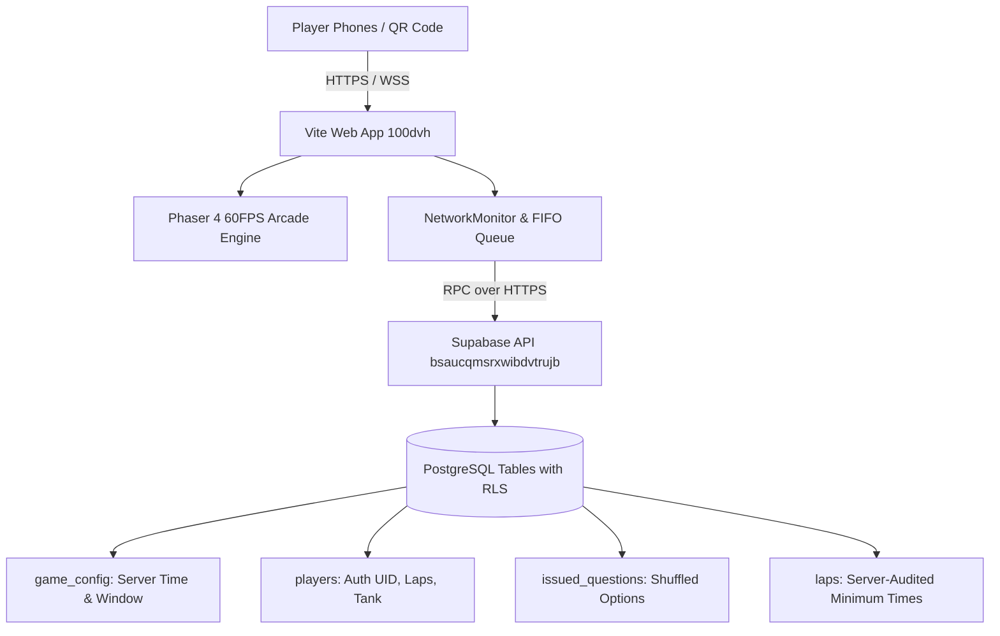

# Crescendo Fuel Rush — Event Day Runbook & Operations Guide

> **Target Event**: FRCRCE Student Council — Crescendo 2026 Flashmob  
> **Event Date & Time**: October 26, 2026 (13:15:00 to 13:45:00 IST)  
> **Expected Traffic**: 100+ concurrent mobile players on venue Wi-Fi & cellular networks  
> **Backend Infrastructure**: Supabase PostgreSQL (`bsaucqmsrxwibdvtrujb.supabase.co`) with Row Level Security (RLS) & Definer RPCs

---

## 1. System Architecture Overview



### Critical Architecture Rules
1. **Source of Truth**: The Supabase database is the absolute source of truth for time, question sequences, fuel allowances, and lap counts.
2. **Client Resiliency**: Client-side network drops never drop laps. Laps enter a persistent in-memory FIFO queue that flushes automatically upon reconnection.
3. **Stale Leaderboard**: If venue Wi-Fi dips or Supabase takes up to 10 seconds to respond, the client displays the last cached snapshot marked with `⚠️ [STALE DATA — RECONNECTING]` without ever freezing or crashing the game.
4. **Hardware Capping**: Device Pixel Ratio is capped at `2.0` on all high-DPI OLED screens to ensure steady 60 FPS on mid-range Android devices and older iPhones.

---

## 2. Pre-Event Deployment Checklist

### T-60 Minutes: Infrastructure & Wi-Fi Check
- [ ] **Venue Wi-Fi**: Confirm venue Wi-Fi AP does not block WebSockets or outbound port `443`.
- [ ] **Cellular Fallback**: Test game loading on Airtel, Jio, and Vodafone 4G/5G tethering.
- [ ] **Supabase Dashboard**: Log into `https://supabase.com/dashboard/project/bsaucqmsrxwibdvtrujb`.
  - Check **Database** -> **Connection Pooling**: Enabled (Transaction pooler on port 6543 / 5432).
  - Check **Authentication** -> **Providers** -> **Anonymous Sign-ins**: Enabled.
  - Check **Authentication** -> **Rate Limits**: Verify anonymous sign-up rate limit is sufficiently high (or students use mixed cellular IP addresses).

### T-30 Minutes: Database State Audit
Run the following SQL check in the Supabase SQL Editor:

```sql
-- 1. Verify Configuration & Tuning
SELECT 
  is_open,
  start_at,
  end_at,
  initial_fuel_ms / 1000 as initial_fuel_sec,
  tank_max_ms / 1000 as tank_max_sec,
  fuel_per_correct_ms / 1000 as fuel_per_correct_sec,
  question_time_ms / 1000 as question_time_sec,
  wrong_lockout_ms / 1000 as wrong_lockout_sec,
  min_lap_ms / 1000 as min_lap_sec
FROM public.game_config;

-- 2. Verify Question Bank (Must be 60 active questions)
SELECT count(*) as active_question_count FROM public.questions WHERE active = true;
```

*Expected output*: `active_question_count = 60`.

### T-15 Minutes: Test Racer Dry Run
1. Scan the event QR code on 1 Android phone and 1 iPhone.
2. Join with name `TestPilot 1` and `TestPilot 2`.
3. Verify:
   - Retro scanline HUD renders crisply.
   - Rotating phone to landscape displays the friendly `ROTATE TO PORTRAIT` blocker and pauses car audio.
   - Thumb controls steer left and right without browser gesture navigation.

---

## 3. Race Window Control Commands

All window adjustments must be run directly from the Supabase SQL Editor by the designated tech lead.

### A. Open the Race Window (Start the Flashmob)
```sql
UPDATE public.game_config
SET 
  is_open = true,
  start_at = now(),
  end_at = now() + interval '30 minutes';

-- Confirm Window Active
SELECT 
  is_open,
  start_at,
  end_at,
  now() as current_time,
  (now() >= start_at AND now() < end_at) as is_active
FROM public.game_config;
```

### B. Extend Race Time (+5 or +10 Minutes)
If the flashmob starts late or dancers request extra time:
```sql
UPDATE public.game_config
SET end_at = end_at + interval '5 minutes';
```

### C. Emergency Kill Switch (Instant Pause)
If an unauthorized intrusion occurs or physical venue equipment fails:
```sql
-- Instantly closes registration and halts further lap/fuel claims
UPDATE public.game_config SET is_open = false;
```

### D. Hard Stop (Checkered Flag)
```sql
-- Forces immediate checkered flag for all active drivers
UPDATE public.game_config SET end_at = now();
```

---

## 4. Live Event Monitoring (During the 30-Minute Race)

Keep two browser tabs open on the operator laptop:

### Tab 1: Live Project Leaderboard
```sql
-- Top 15 Live Leaderboard with Lap Times and Accuracy
SELECT 
  dense_rank() OVER (ORDER BY laps DESC, correct_answers DESC, last_lap_at ASC) as rank,
  name,
  laps,
  correct_answers as correct,
  wrong_answers as wrong,
  round((correct_answers::numeric / nullif(correct_answers + wrong_answers, 0) * 100), 1) as accuracy_pct,
  last_lap_at
FROM public.players
ORDER BY laps DESC, correct_answers DESC, last_lap_at ASC
LIMIT 15;
```

### Tab 2: System Health & Activity Rate
```sql
-- Concurrent Player & Lap Count Monitor
SELECT 
  count(*) as total_registered_players,
  count(*) FILTER (WHERE laps > 0) as active_racers,
  coalesce(sum(laps), 0) as total_laps_completed,
  coalesce(sum(correct_answers), 0) as total_correct_answers
FROM public.players;
```

---

## 5. Post-Race Winner Verification & Anti-Cheat Audit

Before announcing the top 3 winners to the crowd, run the automated verification query to validate that no client manipulated time or bypassed gates:

```sql
-- Winner Integrity Audit
WITH RankedWinners AS (
  SELECT 
    id as player_id,
    name,
    laps,
    correct_answers,
    last_lap_at,
    dense_rank() OVER (ORDER BY laps DESC, correct_answers DESC, last_lap_at ASC) as rank
  FROM public.players
  ORDER BY laps DESC, correct_answers DESC, last_lap_at ASC
  LIMIT 5
)
SELECT 
  rw.rank,
  rw.name,
  rw.laps as total_laps,
  rw.correct_answers,
  count(l.id) as recorded_lap_rows,
  min(l.lap_time_ms) / 1000.0 as fastest_lap_sec,
  round(avg(l.lap_time_ms) / 1000.0, 2) as avg_lap_sec,
  bool_and(l.lap_time_ms >= 36000) as passed_physics_threshold
FROM RankedWinners rw
LEFT JOIN public.laps l ON l.player_id = rw.player_id
GROUP BY rw.rank, rw.name, rw.laps, rw.correct_answers, rw.last_lap_at
ORDER BY rw.rank ASC;
```

### Audit Pass Criteria
1. `recorded_lap_rows` MUST equal `total_laps`.
2. `fastest_lap_sec` MUST be $\ge 36.0\text{ s}$ (physics limit of track at full speed).
3. `passed_physics_threshold` MUST be `true`.

---

## 6. Troubleshooting Runbook

| Symptom | Root Cause | Operator Remedy |
|---|---|---|
| **Yellow banner: `OFFLINE — RECONNECTING` on student phones** | Venue Wi-Fi router saturated / IP pool exhausted | Instruct students to toggle off Wi-Fi and switch to Mobile Data (Jio/Airtel 4G/5G). Laps will automatically sync from the FIFO queue once connected. |
| **`[CACHED / STALE]` tag on leaderboard** | Leaderboard polling delayed by network packet loss | Normal behavior. The HUD displays the last verified ranking and will silently refresh as soon as a query returns. |
| **Phone displays `ROTATE TO PORTRAIT` overlay** | Phone held in landscape or accelerometer tilted > 45° | Ask player to hold device upright in portrait mode. Physics will instantly resume with 0 fuel lost. |
| **Player sees `NETWORK GLITCH! RETRY` in Pit Stop** | Transient connection drop during question fetch | Tap the green `RETRY QUESTION` button. The deadlock-free patch guarantees an immediate question delivery. |
| **Game runs sluggishly on older iPhone/Android** | Phone in iOS Low Power Mode or Android Battery Saver | Recommend player disable Low Power Mode. The engine automatically caps DPR at 2.0 and limits physics delta to 50ms to maintain minimum 30 FPS. |
| **QR Code opens in Instagram / WhatsApp in-app browser** | Social app in-app WebView wrapper | The app features `-webkit-overflow-scrolling: touch` and `100dvh` viewport adaptation. If audio is muted, tap the `🔊` button on top bar to unlock WebAudio. |

---

## 7. Post-Event Cleanup & Reset

To reset the database for the next flashmob session:

```sql
-- Clear previous race data while preserving questions and config
TRUNCATE TABLE public.laps CASCADE;
TRUNCATE TABLE public.issued_questions CASCADE;
DELETE FROM public.players;

-- Verify Clean Slate
SELECT count(*) as remaining_players FROM public.players;
```
